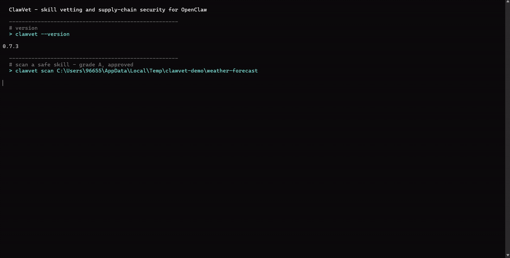

# ClawVet

[](https://github.com/MohibShaikh/clawvet/actions/workflows/ci.yml)
[](https://www.npmjs.com/package/clawvet)
[](https://www.npmjs.com/package/clawvet)

Static and install-time security scanner for AI agent skills, rules, hooks, and MCP configs (**OpenClaw, Claude Code, Cursor, Codex, Windsurf**). ClawVet vets `SKILL.md` and every bundled script it references for prompt injection, credential theft, remote code execution, typosquatting, and rug-pull updates. It runs fully offline by default, with optional LLM (`--semantic`) and OSV.dev (`--osv`) passes when you turn them on.



## Quick start

```bash
# Install once, then run the copy you installed
npm install -g clawvet

# Audit all installed skills, rules, hooks & MCP configs on your machine (prints Machine Permissions Summary)
clawvet audit --summary

# One-command setup for OpenClaw installPolicy + Claude Code PostToolUse guard (supports --dry-run)
clawvet init

# Scan a single skill (prints grade, Permissions summary, and findings)
clawvet scan ./my-skill/

# JSON output for CI/CD
clawvet scan ./my-skill/ --format json --fail-on high
```

Install globally rather than running `npx clawvet`: a fresh `npx` fetch executes whatever version the registry serves at that moment, and cache cleanup breaks `gate` configs. Update deliberately with `npm update -g clawvet`, and verify signed npm provenance with `npm view clawvet dist.attestations`.

## Install-time gate & update checks

`clawvet gate` hooks into OpenClaw's [`security.installPolicy`](https://docs.openclaw.ai/tools/skills-config) so every staged skill is vetted before installation completes, without relying on an agent to remember to scan.

Run `clawvet gate --print-config` and paste the printed block into your OpenClaw config. It resolves through npm's symlink to the real `dist/index.js` and `node` binary, emits `source: "exec"`, and warns on stderr if any path needs `chmod go-w`.

| Risk score | Grade | `scan` | `gate` (`installPolicy`) |
|---|---|---|---|
| 0-25 | A / B | `approve` | `allow` |
| 26-75 | C / D | `warn` | `warn` (stops install and prompts) |
| 76-100 | F | `block` | `block` |

- **Permissions & rug-pull update diff (on by default):** every scan extracts what the skill's code can do (connected sites, credential stores, secret env vars, persistence locations, and proved high-risk behaviours), printed under Permissions by `clawvet scan` and included as `capabilities` in JSON. `clawvet gate` records each allowed install under `~/.local/state/clawvet/installed` (using `XDG_STATE_HOME` or `os.homedir()`, so existing `--print-config` blocks get update checks unchanged). On an update for the same owner and slug, the gate asks (`warn`, naming each new permission) if it adds a secret read, persistence, a high-risk behaviour, or a risky site (the publisher's own GitHub/GitLab account is exempt). Use `--strict` to ask about every new site on updates, or `--no-update-check` to disable comparison.
- **Optional LLM judge (`--semantic`):** sends static findings and coverage gaps to Anthropic or any OpenAI-compatible/local endpoint (Ollama, vLLM) on your own key. Every cleared gap must cite a real quote from the skill, and hard security floors still apply.
- **Baselines (`--baseline <file-or-dir>`):** accept reviewed findings bound to file hashes (`clawvet scan <skill> --write-baseline <file> --reason "..."`).

Full setup details, `chmod g-w,o-w` troubleshooting, coverage profiles (`default` vs `--strict`), limits, and known gaps are in [docs/gate-and-coverage.md](docs/gate-and-coverage.md).

## CI & pre-commit

GitHub Action (scans a skill, optionally uploads SARIF to code scanning, and posts a sticky PR **Permissions Diff** comment with a README trust badge):

```yaml
permissions:
  contents: read
  pull-requests: write     # only for comment-pr
  security-events: write   # only for upload-sarif

steps:
  - uses: actions/checkout@v4
  - uses: MohibShaikh/clawvet@v0.18.0
    with:
      path: skills/my-skill
      fail-on: high
      comment-pr: true
      upload-sarif: true
```

Pre-commit hook (`.pre-commit-config.yaml`):

```yaml
repos:
  - repo: https://github.com/MohibShaikh/clawvet
    rev: v0.17.0
    hooks:
      - id: clawvet
        # args: [--fail-on, medium]   # default is --fail-on high
```

For a repository of skills, run `clawvet audit --dir skills --format json --fail-on high` in CI.

## How it works

Seven passes turn a skill and its bundled scripts into permissions, findings, and a 0-100 risk score. Passes 1-6 are static, offline, and free; Pass 7 (`--semantic`) and `--osv` are opt-in.

| Pass | Module | What it checks |
|---|---|---|
| 1 | `skill-parser`, `sources` | Frontmatter, CommonMark code fences per bundled file, and executable/shebang files |
| 2 | `static-analysis` | Regex rules for RCE, reverse shells, credential theft, OAST canaries, miners, obfuscation, and exfiltration |
| 3 | `dataflow` | Tree-sitter AST taint analysis for Python, JavaScript/TypeScript, and shell (never executed): credential or multi-secret exfil, decoded/remote execution, persistence writes, ransomware loops |
| 4 | `metadata-validator` | Undeclared binaries/env vars, missing descriptions, invalid semver (hygiene only, zero score weight) |
| 5 | `dependency-checker`, `manifests` | `npx -y`, global installs, and pinned dependencies for `--osv` |
| 6 | `typosquat-detector` | Levenshtein distance against popular ClawHub skills |
| 7 | `semantic` | Opt-in (`--semantic`) LLM judge weighing static evidence and coverage gaps |

**Scoring:** findings are weighted by severity and confidence (critical 30, high 15, medium 7, low 3) with geometric repeat decay for identical non-obfuscation matches (converging at 1.33x). A context pass downweights dual-use capabilities when no exfiltration or remote-exec sink exists, promotes credential-read + outbound-send pairs and install-me envelopes, and pins disqualifying indicators (such as known C2 IPs) to grade F.

## Benchmarks

All untrusted skill benchmarks run inside the no-network Docker sandbox ([benchmarks/capability-diff/sandbox.sh](benchmarks/capability-diff/sandbox.sh)).

### SkillTrustBench v1.1 (held-out 556-case leaderboard subset)

| Configuration | Accuracy | Macro F1 | Malicious F1 | Malicious recall |
|---|---|---|---|---|
| `clawvet gate` (static) | 0.660 | 0.511 | 0.815 | 0.788 |
| `clawvet gate --semantic` (Claude Haiku 5.5) | **0.833** | **0.770** | **0.934** | **0.918** |

### Update rug-pull & real-world friction (`v0.16.2` -> `v0.17.0`, held-out test half)

| Metric | `v0.16.2` | `v0.17.0` |
|---|---|---|
| Code-injection rug-pulls caught (gate alone -> gate + diff) | 83.9% | **95.2%** |
| Mixed rug-pulls caught (gate + diff) | - | **95.2%** (100% tune) |
| Benign ClawHub updates stopped (gate + diff) | 65.5% | **34.1%** |
| Benign updates prompting on permission diff | N/A | **5.1%** (12.8% `--strict`) |
| ClawHub unique skills hard-blocked / cleanly allowed (212 skills) | 37.3% / 41.0% | **17.5%** / **65.6%** (0 regressions) |

Full benchmark tables, tune vs test splits, MalSkillBench trade-offs, historical `0.9-0.15` corpora, and prior work are in [docs/benchmarks.md](docs/benchmarks.md).

## Monorepo, development & telemetry

The published npm package `clawvet` contains only `packages/cli` and `packages/shared`, with zero database, Redis, or OAuth dependencies.

| Package | Published | Description |
|---|---|---|
| `packages/cli` | Yes (`npm install -g clawvet`) | Stateless CLI scanner, multi-agent audit, `clawvet init`, and OpenClaw install gate |
| `packages/shared` | Yes (`@clawvet/shared`) | Scanner engine, AST dataflow, capability extractor, patterns |
| `web-demo` | Static site (optional) | Zero-backend browser playground (`@clawvet/shared` + WebAssembly Tree-sitter) |
| `apps/api` | No (optional self-hosted) | Fastify REST API + BullMQ worker (Postgres, Redis, GitHub OAuth) |
| `apps/web` | No (optional self-hosted) | Next.js 14 dashboard |

```bash
npm install
npx turbo test --filter=@clawvet/shared --filter=@clawvet/api
```

<details>
<summary>Optional self-hosted API / web dashboard &amp; API endpoints</summary>

```bash
docker-compose up -d
cd apps/api && npm run db:push && npm run dev
cd apps/web && npm run dev
```

Copy `.env.example` to `.env` (`DATABASE_URL`, `REDIS_URL`, `ANTHROPIC_API_KEY`, `GITHUB_CLIENT_ID`, `GITHUB_CLIENT_SECRET`).

```text
POST   /api/v1/scans          # Submit skill content for scanning
GET    /api/v1/scans/:id      # Get scan result
GET    /api/v1/scans          # List scans (paginated)
GET    /api/v1/stats          # Public stats
POST   /api/v1/webhooks       # Register webhook
DELETE /api/v1/webhooks/:id   # Remove webhook
GET    /api/v1/auth/github    # GitHub OAuth flow
```

</details>

<details>
<summary>Opt-in telemetry details (off unless you opt in)</summary>

Control with `CLAWVET_TELEMETRY=off` or `on` (stored in `~/.clawvet/config.json`). Never sent: raw skill names, file contents, source code, file paths, env vars, API keys, or PII.

| Field | Example | Purpose |
|---|---|---|
| `deviceId` | `a1b2c3d4-...` | Random UUID, not tied to identity |
| `scanCount` | `42` | Scans run on this device |
| `ts`, `os`, `osVersion`, `cliVersion`, `environment` | `linux`, `0.17.0`, `production` | Runtime context (dev/CI filtered out) |
| `skillHash` | `9f2a...` (SHA-256) | Hash of skill name (raw name never sent) |
| `riskScore`, `riskGrade`, `findingsCount`, `cached` | `15`, `B`, `3`, `false` | Aggregate scan outcome |

</details>

## License

MIT
