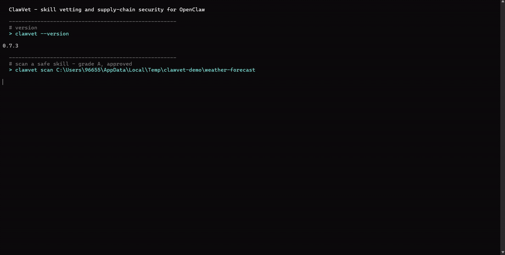

# clawvet

Static and install-time security scanner for OpenClaw and Claude Code skills. ClawVet vets `SKILL.md` and every bundled script it references for prompt injection, credential theft, remote code execution, typosquatting, and rug-pull updates. Offline by default, with optional LLM (`--semantic`) and OSV.dev (`--osv`) passes.



## Install

```bash
npm install -g clawvet
```

Releases are published with signed npm provenance. Check `npm view clawvet dist.attestations` before installing, and update deliberately with `npm update -g clawvet` rather than running `npx clawvet`. Requires Node `>=22.0.0`.

## Usage

```bash
# Scan a local skill (grade, Permissions summary, and findings)
clawvet scan ./my-skill/

# JSON output + CI failure threshold
clawvet scan ./my-skill/ --format json --fail-on high

# Fetch a manifest preview from ClawHub (incomplete coverage; stage locally to clear)
clawvet scan weather-forecast --remote

# Audit all installed OpenClaw and Claude Code skill directories
clawvet audit
clawvet audit --dir ./skills --format json --fail-on high

# Watch skill directories for new installs
clawvet watch --threshold 50
```

## Install-time gate (`clawvet gate`)

`clawvet gate` hooks into OpenClaw's [`security.installPolicy`](https://docs.openclaw.ai/tools/skills-config) so every staged skill install and update is checked before commit.

```bash
clawvet gate --print-config
```

Paste the printed JSON block into your OpenClaw config. `--print-config` resolves through npm's symlink to the real `dist/index.js` and `node` path, sets `source: "exec"`, and prints any needed `chmod go-w` fixes to stderr.

| Risk score | Grade | `scan` | `gate` (`installPolicy`) |
|---|---|---|---|
| 0-25 | A / B | `approve` | `allow` |
| 26-75 | C / D | `warn` | `warn` (stops install and prompts) |
| 76-100 | F | `block` | `block` |

- **Permissions & update checks (on by default):** every scan extracts connected sites, credential stores, secret env vars, persistence locations, and proved high-risk behaviours (printed under Permissions and included as `capabilities` in JSON). `clawvet gate` records each allowed install under `~/.local/state/clawvet/installed` (using `XDG_STATE_HOME` or `os.homedir()`, so existing `--print-config` blocks work without changes). On updates for the same owner and slug, it asks if the new version adds a secret read, persistence, a high-risk behaviour, or a risky site (exempting the publisher's own GitHub/GitLab account). `--strict` asks about every new site on updates; `--no-update-check` disables comparison.
- **Options:** `--block-at <score>` (default `76`), `--strict` (block all inspection gaps), `--semantic` (opt-in LLM judge on your own key), `--osv` (opt-in OSV.dev dependency lookup), and `--baseline <file-or-dir>` (hash-pinned review acceptances via `clawvet scan --write-baseline`).

See [gate-and-coverage.md](https://github.com/MohibShaikh/clawvet/blob/master/docs/gate-and-coverage.md) for troubleshooting (`chmod g-w,o-w`), coverage profiles, limits, and known gaps, and [benchmarks.md](https://github.com/MohibShaikh/clawvet/blob/master/docs/benchmarks.md) for held-out benchmark results.

## What it checks

Seven passes run across `SKILL.md` and every referenced script (Passes 1-6 are static and offline; Pass 7 is opt-in):

| Pass | What it checks |
|---|---|
| **Skill Parser & Assembly** | Frontmatter, per-file CommonMark code fences, recursive local reference resolution, coverage rules |
| **Static Analysis** | RCE, reverse shells, credential theft, OAST canaries, crypto miners, obfuscation, exfiltration |
| **AST Dataflow** | Tree-sitter taint tracking for Python, JS/TS, and shell (never executed): secret exfil, decoded/remote exec, persistence writes, ransomware loops |
| **Metadata Validator** | Undeclared binaries/env vars, missing descriptions, invalid semver (hygiene only, zero score weight) |
| **Dependency Checker** | `npx -y`, global installs, and pinned dependency checks with `--osv` |
| **Typosquat Detector** | Levenshtein distance against popular ClawHub skills |
| **Semantic Judge** | Opt-in (`--semantic`) LLM review of static evidence and coverage gaps |

## CI/CD

GitHub Action (with optional SARIF code-scanning upload):

```yaml
- uses: MohibShaikh/clawvet@v0.17.0
  with:
    path: skills/my-skill
    fail-on: high
    upload-sarif: true   # needs security-events: write
```

Or pin `clawvet` as a devDependency (`npm install --save-dev clawvet`) and run:

```yaml
- name: Vet skills
  run: npx --no-install clawvet audit --dir skills --format json --fail-on high
```

Pre-commit hook (`id: clawvet`) details are in the [repository README](https://github.com/MohibShaikh/clawvet#ci--pre-commit).

## License

MIT
